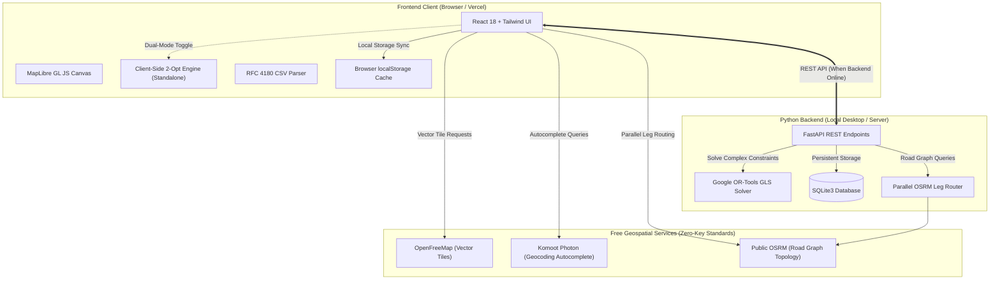

# RouteForge Lite

[](LICENSE)
[](https://react.dev/)
[](https://www.typescriptlang.org/)
[](https://fastapi.tiangolo.com/)
[](https://www.python.org/)
[](https://developers.google.com/optimization)
[](https://maplibre.org/)
[](https://openfreemap.org/)
[](https://vercel.com/)

**RouteForge Lite** is an open-source, free-first multi-stop route planner and Traveling Salesperson Problem (TSP) tour optimization platform. It is engineered exclusively on **open geospatial standards and free-tier infrastructure**—requiring **zero Google Maps API keys, zero Mapbox billing accounts, and zero credit card mandates**.

RouteForge Lite operates in two flexible execution environments:
1. **Full-Stack Local Mode**: High-throughput Python FastAPI backend powered by **Google OR-Tools Guided Local Search (GLS)**, SQLite persistence, and OSRM road graph topology.
2. **Autonomous Cloud Mode**: Fully functional, zero-cost static deployment on **Vercel** powered by an in-browser 2-Opt local search engine, OpenFreeMap vector cartography, and `localStorage` persistence.

---

## Table of Contents

- [Key Features](#key-features)
- [Application Screenshots](#application-screenshots)
- [Architecture Overview](#architecture-overview)
- [Technology Stack](#technology-stack)
- [Installation & Local Setup](#installation--local-setup)
- [Running Locally on Windows](#running-locally-on-windows)
- [CSV / TSV Import Format](#csv--tsv-import-format)
- [Route Optimization Engine](#route-optimization-engine)
- [Map Rendering & OpenFreeMap Integration](#map-rendering--openfreemap-integration)
- [Routing Engine & OSRM Integration](#routing-engine--osrm-integration)
- [Live Traffic Status & Roadmap](#live-traffic-status--roadmap)
- [Deployment Guide (Vercel & Cloud)](#deployment-guide-vercel--cloud)
- [Configuration & Environment Variables](#configuration--environment-variables)
- [Known Limitations](#known-limitations)
- [Project Roadmap](#project-roadmap)
- [License](#license)

---

## Key Features

- **1-Click TSP Sequence Optimization**:
  - Solves complex multi-stop routes to minimize travel distance and driving duration.
  - Supports **open-ended tours** (dummy sink formulation), **fixed start/end constraints**, and **locked waypoint invariants** (🔒).
  - Displays instant before/after performance audit: total kilometers saved, percentage efficiency gain, and fuel/carbon reductions.
- **Universal RFC 4180 CSV / TSV Importer**:
  - Robust tokenizer properly handles quoted cells with commas, newlines, and escaped quotes (`""`).
  - Intelligent column detection automatically detects `Latitude`/`lat`, `Longitude`/`lon`/`lng`, stop names, and address parts.
  - Sub-meter coordinate preservation bypasses external geocoding delays entirely, loading national-scale tours in milliseconds.
  - Interactive live preview modal with coordinate validation chips and clean replacement toggles.
- **OpenFreeMap Vector Cartography**:
  - Powered by MapLibre GL JS rendering vector tiles from OpenFreeMap.
  - Three switchable styles: **Positron** (light, minimal), **Liberty** (detailed topological contours), and **Bright** (high contrast).
  - 100% free forever: zero API keys, no monthly transaction caps, and zero watermarks.
- **Parallel Highway Routing Engine**:
  - Employs parallel pairwise leg querying via OSRM, eliminating timeouts on continental-scale tours.
  - Stitches hundreds of road curve coordinates to follow real motorways, bypasses, and mountain passes instead of straight scale lines.
- **Multi-Modal Transit Estimation**:
  - Transit profiles with duration estimations for **Driving** (Car), **Cycling** (Bicycle), and **Walking** (Pedestrian).
- **Sub-Meter Pinpoint Tool ("Drop Pin")**:
  - Interactive crosshair tool for dropping custom pins anywhere on the map with sub-meter coordinate resolution.
  - Fully draggable markers with instant coordinate re-anchoring.
- **High-Speed Geocoding & Coordinate Parser**:
  - Direct coordinate and URL parser: detects raw `lat, lng` pairs, DMS notation, Google Maps URLs, and OpenStreetMap URLs instantly.
  - Live address autocomplete via Komoot Photon with fallback to OpenStreetMap Nominatim.

---

## Application Screenshots

<!-- 
NOTE FOR CONTRIBUTORS:
Genuine screenshots from the running application should be placed in `docs/assets/` and linked below.
Do not use AI-generated mockups or non-functional design illustrations.
-->

| Route Planner & Optimizer | Stop Management & Metrics |
| :---: | :---: |
| *[ Insert genuine screenshot of running map planner with optimized route ]* | *[ Insert genuine screenshot of waypoints sidebar and efficiency audit ]* |

*Place screenshots in `docs/assets/planner_screenshot.png` and `docs/assets/landing_screenshot.png` to display here.*

---

## Architecture Overview

RouteForge Lite features a decoupled, fail-safe architecture designed for both local high-performance optimization and serverless cloud deployment:



### Architectural Separation
- **When running locally with Python**: The client syncs with the FastAPI backend at `http://127.0.0.1:8000`. Complex tours are solved by Google OR-Tools using Guided Local Search with penalty formulations, and route revisions are persisted in SQLite.
- **When deployed to Vercel (or when backend is offline)**: The client operates completely autonomously. Optimization runs via an in-memory 2-Opt TSP metaheuristic in WebAssembly/JavaScript, road geometries are fetched directly from OSRM, and state is preserved in `localStorage`.

---

## Technology Stack

| Layer | Technologies | Role in System |
| :--- | :--- | :--- |
| **Frontend UI** | React 18, TypeScript, Tailwind CSS, Lucide Icons | Responsive single-page application and editorial control interface |
| **Build System** | Vite 5, PostCSS, Autoprefixer | Sub-second HMR and minified static production bundling |
| **Map Engine** | MapLibre GL JS 4.7, WebGL | High-performance vector tile rendering, smooth camera zoom, and marker dragging |
| **Vector Tiles** | OpenFreeMap (Positron, Liberty, Bright) | Community-hosted, keyless OpenStreetMap vector tile sets |
| **Geocoding** | Komoot Photon, OpenStreetMap Nominatim | Sub-meter geocoding, reverse geocoding, and direct coordinate parsing |
| **Routing Engine** | Project OSRM (Open Source Routing Machine) | Real road network distance matrices and highway curve geometries |
| **Backend API** | Python 3.10+, FastAPI, Uvicorn, HTTPX | High-concurrency asynchronous REST endpoints and static file serving |
| **Tour Solver** | Google OR-Tools 9.9 (Python) + 2-Opt (Client) | Combinatorial TSP optimization with GLS and constraint handling |
| **Database** | SQLite3 with WAL mode | Local ACID persistence with optimistic revision-locking guards |

---

## Installation & Local Setup

### Prerequisites
- **Node.js**: v18.0.0 or higher ([Download Node.js](https://nodejs.org/))
- **Python**: v3.10 or higher ([Download Python](https://www.python.org/))
- **Git**: ([Download Git](https://git-scm.com/))

### 1. Clone the Repository
```bash
git clone https://github.com/Chauhan-legacy/Route-ForgeLite.git
cd Route-ForgeLite
```

### 2. Backend Setup (Python)
Create and activate a virtual environment, then install dependencies:

**On Windows (Command Prompt):**
```cmd
python -m venv venv
venv\Scripts\activate
pip install -r requirements.txt
```

**On Linux / macOS:**
```bash
python3 -m venv venv
source venv/bin/activate
pip install -r requirements.txt
```

### 3. Frontend Setup (React / Vite)
Install client-side dependencies:
```bash
cd local/client
npm install
cd ../..
```

---

## Running Locally on Windows

You have three options for local development depending on your workflow:

### Option A: 1-Click Launch (Recommended for Windows)
Double-click `start_routeforge.bat` in the root folder, or execute it in CMD:
```cmd
start_routeforge.bat
```
*This script automatically checks the Python virtual environment, builds client assets, starts the FastAPI server on `http://127.0.0.1:8000`, and opens your default browser.*

To stop the server safely:
```cmd
stop.bat
```

### Option B: Standalone Frontend Mode (Zero Backend Dependency)
If you only want to work on the UI or test Vercel standalone behavior without starting Python:
```cmd
cd local/client
npm run dev
```
*Open `http://localhost:5173`. The application runs 100% autonomously using in-browser 2-opt optimization, client-side OSRM routing, and localStorage persistence.*

### Option C: Manual Full-Stack Development
If you are developing both the React client and FastAPI endpoints simultaneously:
1. **Terminal 1 (Backend)**:
   ```cmd
   venv\Scripts\activate
   python backend/run_server.py
   ```
2. **Terminal 2 (Frontend with Hot-Reload)**:
   ```cmd
   cd local/client
   npm run dev
   ```

---

## CSV / TSV Import Format

RouteForge Lite features an RFC 4180-compliant CSV parser capable of parsing custom spreadsheets, logistics manifests, and tour itineraries.

### Supported Columns
The parser automatically detects column headers regardless of casing, spacing, or underscores:
- **Latitude**: `Latitude`, `lat`, `lat_deg`, `y`, `gps_lat`
- **Longitude**: `Longitude`, `lon`, `lng`, `long`, `x`, `gps_lon`
- **Name / Title**: `Jyotirlinga_Name`, `Temple_Name`, `Stop_Name`, `name`, `title`, `landmark`
- **Address**: `City_Town`, `City`, `District`, `State`, `Address`, `addr`, `location`
- **Locked**: `Locked`, `fixed`, `pinned` (`yes`/`true`/`1` fixes the stop's sequence order)

### Working Example: 12 Jyotirlinga Pilgrimage Route
Save the following as a `.csv` file and upload it using the **Import** modal:

```csv
Stop_No,Jyotirlinga_Name,Temple_Name,City_Town,District,State,Latitude,Longitude,Significance
1,Somnath,Shri Somnath Jyotirlinga Temple,"Prabhas Patan, Veraval",Gir Somnath,Gujarat,20.888,70.4012,"First among the 12 Jyotirlingas, situated on the western coast."
2,Nageshwar,Nageshvara Jyotirlinga Temple,Dwarka,Devbhoomi Dwarka,Gujarat,22.4707,69.0773,"Symbolizes protection from poison and evil, near coastal Dwarka."
3,Mahakaleshwar,Shri Mahakaleshwar Temple,Ujjain,Ujjain,Madhya Pradesh,23.1828,75.7682,"Only south-facing (Dakshinamukhi) Jyotirlinga, Lord of Time."
4,Omkareshwar,Shri Omkareshwar Temple,Mandhata Island,Khandwa,Madhya Pradesh,22.2475,76.1517,Located on an island shaped like the sacred Om on the Narmada River.
5,Bhimashankar,Shri Bhimashankar Temple,Bhimashankar,Pune,Maharashtra,19.0739,73.5351,"Source of the Bhima River, nestled in the Sahyadri Hills."
6,Trimbakeshwar,Shri Trimbakeshwar Temple,Trimbak,Nashik,Maharashtra,19.9333,73.5333,Source of the Godavari River; three-faced lingam representing Trimurti.
7,Grishneshwar,Shri Grishneshwar Temple,Verul,Chhatrapati Sambhajinagar,Maharashtra,20.0232,75.1764,"Last of the 12 Jyotirlingas, located near the UNESCO Ellora Caves."
8,Mallikarjuna,Shri Mallikarjuna Swamy Temple,Srisailam,Nandyal,Andhra Pradesh,16.0743,78.8682,Set in Nallamala Hills; both a Jyotirlinga and a Shakti Peetha.
9,Ramanathaswamy,Ramanathaswamy Temple,Rameswaram,Ramanathapuram,Tamil Nadu,9.2881,79.3129,"Southernmost Jyotirlinga, established by Lord Rama before crossing to Lanka."
10,Kashi Vishwanath,Shri Kashi Vishwanath Temple,Varanasi,Varanasi,Uttar Pradesh,25.3113,83.0104,Located in the holy city of Varanasi on the banks of the Ganges.
11,Vaidyanath,Vaidyanath Temple (Baidyanath Dham),Deoghar,Deoghar,Jharkhand,24.4826,86.7013,Known as the wish-fulfilling Kamna Linga and healing shrine.
12,Kedarnath,Shri Kedarnath Temple,Kedarnath,Rudraprayag,Uttarakhand,30.7352,79.0669,Highest altitude Jyotirlinga in the Garhwal Himalayas; open May–October.
```

### Import Features
- **Quoted Commas Handled**: Quoted fields such as `"Prabhas Patan, Veraval"` are correctly parsed without column shifting.
- **Zero-Lag Loading**: Because exact GPS coordinates are present, all 12 stops load in `< 50 ms` with zero external geocoding requests.
- **Auto-Framing**: The map camera automatically adjusts bounds to display the entire route across India upon import.

---

## Route Optimization Engine

RouteForge Lite solves the NP-hard **Traveling Salesperson Problem (TSP)** and multi-stop vehicle routing challenges through mathematical optimization models:

### 1. Backend Optimization (Google OR-Tools)
- **Algorithm**: `RoutingIndexManager` and `RoutingModel` using **Guided Local Search (GLS)** metaheuristics with `PATH_CHEAPEST_ARC` first-solution strategies.
- **Open-Ended TSP (Dummy Sink Formulation)**: Allows delivery drivers and travelers to start at an origin and finish at the most efficient final destination without being forced into an unnatural roundtrip loop.
- **Constraint Matrix**:
  - `fixedStart: true` anchors stop 0 as the starting depot.
  - `fixedEnd: true` anchors stop $N-1$ as the required terminus.
  - `lockedStops: true` respects intermediate locked invariants (stops marked with 🔒 preserve their exact sequence position).
- **Execution Speed**: Solves 50-stop routes in `< 250 ms`.

### 2. Client-Side Standalone Optimization (2-Opt Local Search)
- **Algorithm**: Nearest Neighbor construction followed by iterative **2-Opt edge exchange local search**.
- **Operation**: Runs entirely inside the browser's JavaScript runtime when hosted on Vercel or offline.
- **Honest Telemetry**: Correctly distinguishes between genuine distance improvements and routes that are already optimal, avoiding misleading savings claims.

---

## Map Rendering & OpenFreeMap Integration

RouteForge Lite integrates [OpenFreeMap](https://openfreemap.org/) vector cartography rendered via **MapLibre GL JS**:

- **Zero API Keys & Zero Tokens**: Completely independent of proprietary map services. No billing accounts, credit cards, or quotas.
- **Vector Styles Supported**:
  - `Positron`: Clean, light, minimal aesthetic for business logistics.
  - `Liberty`: Detailed topographic map with elevation contours, forests, and road classifications.
  - `Bright`: High-contrast cartography optimized for bright daylight conditions.
- **Interactive Capabilities**:
  - Smooth 60 FPS WebGL rendering with crisp vector typography.
  - Real-time marker dragging with instant coordinate snapping.
  - Responsive camera bounding-box calculation (`fitBounds`) with adaptive padding.

---

## Routing Engine & OSRM Integration

To calculate real driving distances and road geometries, RouteForge Lite interfaces with public **Open Source Routing Machine (OSRM)** instances:

### Parallel Pairwise Highway Routing
Instead of sending a massive 12+ stop multi-kilometer query that can time out on public servers, RouteForge Lite queries route legs concurrently:
1. Route segments $(P_1 \to P_2, P_2 \to P_3, \dots, P_n \to P_{n+1})$ are dispatched in parallel via `Promise.all` (client) or `asyncio.gather` (backend).
2. Road geometry coordinates are stitched into a continuous GeoJSON `LineString`.
3. The resulting route follows real highways (e.g. NH-48, NH-44, interstate freeways) rather than straight scale lines.
4. If a specific leg cannot be routed (e.g., an off-road Himalayan hiking trail to Kedarnath), that specific leg falls back gracefully to geodesic distance while all other motorable legs preserve exact road geometry.

---

## Live Traffic Status & Roadmap

To maintain clear transparency regarding real-time traffic capabilities:

### Currently Implemented
- **Estimated Travel Duration**: Route duration is calculated using realistic mode-specific speed models (Driving: ~50 km/h baseline; Cycling: ~15 km/h; Walking: ~4.5 km/h) combined with OSRM road graph speeds.
- **Traffic Status Indicator**: A visible disclaimer chip informs users:
  > *"Duration based on real OSRM road graph topology. Live traffic is unavailable."*

### Planned Traffic Roadmap
- [ ] **Real-Time Congestion Overlay**: Integration of vector traffic flow tiles from free-tier providers (such as TomTom 2,500 req/day or HERE Maps 250,000 transactions/month) with color-coded speed brackets (Green, Yellow, Red, Dark Red).
- [ ] **Dynamic Congestion Cost Matrix**: Modulating distance costs with real-time delay multipliers $\tau_{ij}$:
  $$C_{ij} = d_{ij} \times \tau_{ij}$$
  allowing Google OR-Tools to divert routes around urban bottlenecks.
- [ ] **Proactive Re-Routing**: Periodic background polling alerting drivers when a faster alternative route becomes available.

---

## Deployment Guide (Vercel & Cloud)

RouteForge Lite supports multiple deployment models:

### 1. Vercel Cloud Deployment (Standalone Client)
The easiest way to deploy RouteForge Lite with **₹0 hosting costs**:

Because the frontend contains a standalone in-browser TSP optimizer and connects directly to free public OSRM and OpenFreeMap endpoints, **the client can run completely without a Python backend on Vercel**.

1. Push your repository to GitHub:
   ```bash
   git push -u origin main
   ```
2. Log in to [Vercel](https://vercel.com/) and click **Add New... &rarr; Project**.
3. Import your **`Route-ForgeLite`** repository.
4. Vercel automatically detects [`vercel.json`](vercel.json):
   - **Framework Preset**: Vite
   - **Root Directory**: `./`
   - **Build Command**: `npm --prefix local/client run build`
   - **Output Directory**: `local/client/dist`
5. Click **Deploy**. Your site will be live on a `*.vercel.app` domain.

### 2. Backend Cloud Hosting (Optional)
If you wish to deploy the Python FastAPI backend with Google OR-Tools in the cloud:
- **Render / Railway / Fly.io**: Deploy using the included [`render.yaml`](render.yaml) or [`Dockerfile`](Dockerfile).
- **Environment**: Set `PORT=8000` and start command `python backend/run_server.py`.
- **Client Configuration**: Point `VITE_API_BASE` in the client to your deployed backend URL.

---

## Configuration & Environment Variables

### Backend Configuration
Configure through environment variables or a `.env` file in the root folder:

| Variable | Default Value | Description |
| :--- | :--- | :--- |
| `PORT` | `8000` | Port for the FastAPI server |
| `HOST` | `127.0.0.1` | Network bind address (`0.0.0.0` for containerized hosting) |
| `DATABASE_PATH` | `database/routeforge.db` | Relative or absolute path to the SQLite database |
| `ALLOW_ORIGINS` | `*` | Allowed CORS origins for cross-domain API access |

### Frontend Configuration
Configure through `local/client/.env`:

| Variable | Default Value | Description |
| :--- | :--- | :--- |
| `VITE_API_BASE` | `http://127.0.0.1:8000` | Base URL of the backend API (falls back to client mode if offline) |

---

## Known Limitations

- **Public OSRM Fair-Use Quotas**: The demo OSRM server (`router.project-osrm.org`) is a shared community resource. Extremely large routes (> 80 waypoints) should be broken into smaller corridors to avoid rate limiting. For enterprise logistics, self-hosting an OSRM Docker container is recommended.
- **Off-Grid & Wilderness Locations**: Locations situated far from mapped road networks (e.g. remote hiking shrines or island lighthouses) may use straight-line geodesic fallbacks for the unpaved segments.
- **Offline Autocomplete**: Address searching requires an internet connection to query Komoot Photon. However, direct coordinate pasting (`lat, lng`) works completely offline.

---

## Project Roadmap

- [x] High-precision RFC 4180 CSV parser with custom coordinate header detection.
- [x] Parallel pairwise OSRM highway curve routing.
- [x] Google OR-Tools open-ended TSP solver with locked waypoint invariants.
- [x] Dual-mode deployment: Full-stack FastAPI or Vercel standalone.
- [x] Sub-meter pinpoint crosshair tool and draggable marker coordinate snapping.
- [ ] GPX and KML format export for Garmin, Strava, and Google Earth.
- [ ] Time-window vehicle routing (VRPTW) supporting customer delivery schedules.
- [ ] Live traffic flow tile overlay and congestion-weighted cost matrices.

---

## License

This project is licensed under the **MIT License**. See the [`LICENSE`](LICENSE) file for details.

```text
MIT License
Copyright (c) 2026 RouteForge Contributors
```
