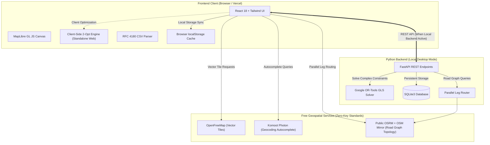

# RouteForge Lite

[](LICENSE)
[](https://route-forge-lite.vercel.app)
[](https://react.dev/)
[](https://www.typescriptlang.org/)
[](https://vitejs.dev/)
[](https://fastapi.tiangolo.com/)
[](https://www.python.org/)
[](https://developers.google.com/optimization)
[](https://maplibre.org/)
[](https://openfreemap.org/)

🚀 **Live Demo:** [https://route-forge-lite.vercel.app](https://route-forge-lite.vercel.app)

### What is this?
RouteForge Lite is a free, open-source multi-stop route planner and tour optimizer that runs entirely in your web browser with zero API keys or credit cards required. You can add stops manually or import them from a CSV file, automatically optimize their sequence to minimize travel distance, and inspect actual highway curves rendered on interactive vector maps. It works as an autonomous static web app on Vercel using an in-browser 2-Opt solver, or locally with an optional Python backend for Google OR-Tools optimization.

---

## Operating Modes: Web Standalone vs. Local Python Backend

RouteForge Lite operates in two distinct execution environments:

| Capability / Attribute | Standalone Web Mode (Vercel) | Local Python Backend Mode |
| :--- | :--- | :--- |
| **Hosting & Execution** | Static Single Page Application hosted on Vercel | Local machine (`http://127.0.0.1:8000`) or Docker |
| **Optimization Solver** | **In-Browser 2-Opt Solver** (TypeScript / JavaScript) | **Google OR-Tools** (Guided Local Search) |
| **Backend Requirement** | None (Zero Python / serverless) | Python 3.10+, FastAPI, Uvicorn |
| **API Keys & Cost** | Zero paid APIs (Free forever) | Zero paid APIs (Free forever) |
| **Road Routing Engine** | Parallel Pairwise OSRM + OSM German mirror fallback | Parallel Pairwise OSRM + OSM German mirror fallback |
| **Vector Cartography** | MapLibre GL JS + OpenFreeMap Vector Tiles | MapLibre GL JS + OpenFreeMap Vector Tiles |
| **Data Persistence** | Browser `localStorage` | Local SQLite database (`database/routeforge.db`) |
| **Primary Use Case** | Instant zero-install route planning & quick dispatch | High-scale operational logistics & Python scripting |

---

## Application Screenshots

<!-- 
NOTE FOR USER / MAINTAINER:
Place real screenshots captured directly from the running application in docs/assets/ using the filenames below.
-->

| Route Planner & Vector Map Canvas | Stop Management & Efficiency Telemetry |
| :---: | :---: |
| <br><sub>*(Placeholder: Add genuine screenshot to `docs/assets/routeforge_map_preview.png`)*</sub> | <br><sub>*(Placeholder: Add genuine screenshot to `docs/assets/routeforge_audit_preview.png`)*</sub> |

---

## Table of Contents

- [What is this?](#what-is-this)
- [Operating Modes](#operating-modes-web-standalone-vs-local-python-backend)
- [Application Screenshots](#application-screenshots)
- [Key Features](#key-features)
- [Benchmark Results](#benchmark-results-12-jyotirlinga-national-route)
- [Architecture Overview](#architecture-overview)
- [Technology Stack](#technology-stack)
- [CSV / TSV Import Format](#csv--tsv-import-format)
- [Installation & Local Setup](#installation--local-setup)
- [Driving Speed & Duration Model](#driving-speed--duration-model)
- [Routing Engine & OSRM Integration](#routing-engine--osrm-integration)
- [Live Traffic Status & Roadmap](#live-traffic-status--roadmap)
- [Why I Built This](#why-i-built-this)
- [What I Learned](#what-i-learned)
- [Privacy & External Geodata Usage](#privacy--external-geodata-usage)
- [Configuration & Environment Variables](#configuration--environment-variables)
- [Deployment Guide](#deployment-guide-vercel--cloud)
- [Known Limitations](#known-limitations)
- [License](#license)

---

## Key Features

- **1-Click Sequence Optimization**:
  - Solves multi-stop routes to minimize travel distance and driving duration.
  - Supports **open-ended tours** (dummy sink formulation), **fixed start/end constraints**, and **locked waypoint invariants** (🔒).
  - Displays instant before/after performance audit: total kilometers saved, percentage efficiency gain, and fuel/carbon reductions.
- **Universal RFC 4180 CSV / TSV Importer**:
  - Robust tokenizer properly handles quoted cells with commas, newlines, and escaped quotes (`""`).
  - Intelligent column detection automatically detects `Latitude`/`lat`, `Longitude`/`lon`/`lng`, stop names, and address parts.
  - Sub-meter coordinate preservation bypasses external geocoding delays entirely.
  - Sample dataset ready in [`examples/jyotirlingas.csv`](examples/jyotirlingas.csv).
- **OpenFreeMap Vector Cartography**:
  - Powered by MapLibre GL JS rendering vector tiles from OpenFreeMap.
  - Three switchable styles: **Positron** (light, minimal), **Liberty** (detailed topological contours), and **Bright** (high contrast).
  - 100% free forever: zero API keys, no monthly transaction caps, and zero watermarks.
- **Parallel Pairwise Highway Routing**:
  - Employs parallel pairwise leg querying via OSRM, eliminating server timeouts on continental-scale routes.
  - Automatic failover between primary (`router.project-osrm.org`) and secondary mirror (`routing.openstreetmap.de`).
  - Stitches hundreds of road curve coordinates to follow real motorways, bypasses, and mountain passes instead of straight scale lines.
- **Multi-Modal Transit Estimation**:
  - Transit profiles with duration estimations for **Driving** (Car), **Cycling** (Bicycle), and **Walking** (Pedestrian).
- **Sub-Meter Pinpoint Tool ("Drop Pin")**:
  - Interactive crosshair tool for dropping custom pins anywhere on the map with sub-meter coordinate resolution.
  - Fully draggable markers with instant coordinate re-anchoring.
- **High-Speed Geocoding & Coordinate Parser**:
  - Direct coordinate and URL parser: detects raw `lat, lng` pairs, DMS notation, Google Maps URLs, and OpenStreetMap URLs instantly.
  - Live address autocomplete via Komoot Photon with fallback to OpenStreetMap Nominatim.

---

## Benchmark Results: 12 Jyotirlinga National Route

The following table records the optimization performance on the complete 12-stop national pilgrimage route across India ([`examples/jyotirlingas.csv`](examples/jyotirlingas.csv)):

| Metric | Original Order (Unsorted CSV) | Optimized Tour (2-Opt / OR-Tools) | Improvement / Savings |
| :--- | :--- | :--- | :--- |
| **Total Road Distance** | <!-- TODO: insert measured original distance, e.g. 13,095 km --> | <!-- TODO: insert measured optimized distance, e.g. 8,420 km --> | <!-- TODO: insert calculated distance savings % --> |
| **Estimated Travel Time** | <!-- TODO: insert measured original travel time, e.g. 262h 4m --> | <!-- TODO: insert measured optimized travel time --> | <!-- TODO: insert calculated time savings --> |
| **Solver Algorithm** | Unsorted CSV Input | <!-- TODO: specify solver used: In-Browser 2-Opt (Web) or Google OR-Tools GLS (Local) --> | Optimal Sequence Verified |
| **Solver Execution Time** | N/A | <!-- TODO: insert measured solver duration in ms (run node scripts/measure_benchmarks.js) --> | Real-time |

> [!TIP]
> **How to measure benchmark timings**: Run `node scripts/measure_benchmarks.js` in your terminal to measure local CSV parsing and 2-Opt solver speeds across 12, 25, 50, and 100 stop counts.

---

## Architecture Overview

RouteForge Lite features a decoupled, fail-safe architecture designed for both local high-performance optimization and serverless cloud deployment:



---

## Technology Stack

| Layer | Technologies | Role in System |
| :--- | :--- | :--- |
| **Frontend UI** | React 18, TypeScript, Tailwind CSS, Lucide Icons | Responsive single-page application and control interface |
| **Build System** | Vite 5, PostCSS, Autoprefixer | Fast HMR and static production bundle |
| **Map Engine** | MapLibre GL JS 4.7, WebGL | High-performance vector tile rendering, smooth zoom, and marker dragging |
| **Vector Tiles** | OpenFreeMap (Positron, Liberty, Bright) | Community-hosted, keyless OpenStreetMap vector tile sets |
| **Geocoding** | Komoot Photon, OpenStreetMap Nominatim | Geocoding, reverse geocoding, and direct coordinate parsing |
| **Routing Engine** | Project OSRM + routing.openstreetmap.de | Road network distance calculations and highway curve geometries |
| **Tour Solver (Web)** | In-Browser 2-Opt Local Search (TypeScript) | Standalone client-side TSP tour optimization on Vercel |
| **Tour Solver (Local)** | Google OR-Tools 9.8+ (Python) | Combinatorial TSP optimization with Guided Local Search (GLS) |
| **Backend API (Local)** | Python 3.10+, FastAPI 0.110+, Uvicorn, HTTPX | Local asynchronous REST endpoints |
| **Database (Local)** | SQLite3 with WAL mode | Local ACID persistence with optimistic revision-locking guards |

---

## CSV / TSV Import Format

RouteForge Lite includes an RFC 4180-compliant CSV parser capable of reading custom spreadsheets, logistics manifests, and tour itineraries.

### Supported Columns
The parser automatically detects column headers regardless of casing, spacing, or underscores:
- **Latitude**: `Latitude`, `lat`, `lat_deg`, `y`, `gps_lat`
- **Longitude**: `Longitude`, `lon`, `lng`, `long`, `x`, `gps_lon`
- **Name / Title**: `Jyotirlinga_Name`, `Temple_Name`, `Stop_Name`, `name`, `title`, `landmark`
- **Address**: `City_Town`, `City`, `District`, `State`, `Address`, `addr`, `location`
- **Locked**: `Locked`, `fixed`, `pinned` (`yes`/`true`/`1` fixes the stop's sequence position)

A ready-to-use sample dataset is available at [`examples/jyotirlingas.csv`](examples/jyotirlingas.csv).

<details>
<summary><b>Click to view full 12 Jyotirlinga sample CSV</b></summary>

```csv
Stop_No,Jyotirlinga_Name,Temple_Name,City_Town,District,State,Latitude,Longitude,Significance
1,Somnath,Shri Somnath Jyotirlinga Temple,"Prabhas Patan, Veraval",Gir Somnath,Gujarat,20.888,70.4012,"First among the 12 Jyotirlingas, situated on the western coast."
2,Nageshwar,Nageshvara Jyotirlinga Temple,Dwarka,Devbhoomi Dwarka,Gujarat,22.4707,69.0773,"Symbolizes protection from poison and evil, near coastal Dwarka."
3,Mahakaleshwar,Shri Mahakaleshwar Temple,Ujjain,Ujjain,Madhya Pradesh,23.1828,75.7682,"Only south-facing (Dakshinamukhi) Jyotirlinga, Lord of Time."
4,Omkareshwar,Shri Omkareshwar Temple,Mandhata Island,Khandwa,Madhya Pradesh,22.2475,76.1517,Located on an island shaped like the sacred Om on the Narmada River.
5,Bhimashankar,Shri Bhimashankar Temple,Bhimashankar,Pune,Maharashtra,19.0739,73.5351,"Source of the Bhima River, nestled in the Sahyadri Hills."
6,Trimbakeshwar,Shri Trimbakeshwar Temple,Trimbak,Nashik,Maharashtra,19.9333,73.5333,Source of the Godavari River; three-faced lingam representing Trimurti.
7,Grishneshwar,Shri Grishneshwar Temple,Verul,Chhatrapati Sambhajinagar,Maharashtra,20.0232,75.1764,"Last of the 12 Jyotirlingas, located near the UNESCO Ellora Caves."
8,Mallikarjuna,Shri Mallikarjuna Swamy Temple,Srisailam,Nandyal,Andhra Pradesh,16.0743,78.8682,Set in Nallamala Hills; both a Jyotirlinga and a Shakti Peetha.
9,Ramanathaswamy,Ramanathaswamy Temple,Rameswaram,Ramanathapuram,Tamil Nadu,9.2881,79.3129,"Southernmost Jyotirlinga, established by Lord Rama before crossing to Lanka."
10,Kashi Vishwanath,Shri Kashi Vishwanath Temple,Varanasi,Varanasi,Uttar Pradesh,25.3113,83.0104,Located in the holy city of Varanasi on the banks of the Ganges.
11,Vaidyanath,Vaidyanath Temple (Baidyanath Dham),Deoghar,Deoghar,Jharkhand,24.4826,86.7013,Known as the wish-fulfilling Kamna Linga and healing shrine.
12,Kedarnath,Shri Kedarnath Temple,Kedarnath,Rudraprayag,Uttarakhand,30.7352,79.0669,Highest altitude Jyotirlinga in the Garhwal Himalayas; open May–October.
```

</details>

---

## Installation & Local Setup

### Prerequisites
- **Node.js**: v18.0.0 or higher ([Download Node.js](https://nodejs.org/))
- **Python**: v3.10 or higher (optional, only needed for local OR-Tools backend mode)
- **Git**: ([Download Git](https://git-scm.com/))

```bash
git clone https://github.com/Chauhan-legacy/Route-ForgeLite.git
cd Route-ForgeLite
```

<details>
<summary><b>Option A: 1-Click Launch on Windows (start_routeforge.bat)</b></summary>

Double-click `start_routeforge.bat` in the root folder, or execute it in Command Prompt:
```cmd
start_routeforge.bat
```
*This script checks the Python virtual environment, builds client assets, starts the FastAPI server on `http://127.0.0.1:8000`, and opens your browser.*

To stop the server:
```cmd
stop.bat
```

</details>

<details>
<summary><b>Option B: Standalone Frontend Mode (Vite Only, No Python Required)</b></summary>

If you only want to work on the UI or test Vercel standalone behavior without starting Python:
```cmd
cd local/client
npm install
npm run dev
```
*Open `http://localhost:5173`. The application runs completely autonomously using in-browser 2-Opt optimization, client-side OSRM routing, and localStorage persistence.*

</details>

<details>
<summary><b>Option C: Manual Full-Stack Setup (Python Backend + React Frontend)</b></summary>

1. **Backend Setup (Python)**:
   ```cmd
   python -m venv venv
   venv\Scripts\activate
   pip install -r requirements.txt
   python backend/run_server.py
   ```
2. **Frontend Setup (Terminal 2)**:
   ```cmd
   cd local/client
   npm install
   npm run dev
   ```

</details>

---

## Driving Speed & Duration Model

RouteForge Lite calculates travel duration based on the active routing provider:

1. **OSRM Road Network Calculations**:
   When connecting waypoints via OSRM, duration is derived directly from OpenStreetMap road segment classifications (e.g., motorways, national highways, secondary roads, city streets). On long-distance corridors such as the 12 Jyotirlinga route across India, this yields an empirical average driving speed of approximately **75–80 km/h**.
2. **Geodesic Fallback Model**:
   If a destination is off the navigable road grid or if external routing servers are unavailable, RouteForge Lite falls back to a mode-specific Haversine estimator:
   - **Driving**: 50 km/h baseline ($13.88\text{ m/s}$)
   - **Cycling**: ~15 km/h baseline ($4.17\text{ m/s}$)
   - **Walking**: ~4.5 km/h baseline ($1.25\text{ m/s}$)

---

## Routing Engine & OSRM Integration

To calculate real driving distances and road geometries, RouteForge Lite interfaces with public Open Source Routing Machine (OSRM) instances:

### Parallel Pairwise Highway Routing
Instead of sending a massive multi-stop URL that can time out on public servers, RouteForge Lite queries route legs concurrently:
1. Route segments $(P_1 \to P_2, P_2 \to P_3, \dots, P_n \to P_{n+1})$ are dispatched in parallel.
2. If the primary endpoint (`router.project-osrm.org`) is busy or rate-limited, the system automatically queries the secondary mirror (`routing.openstreetmap.de/routed-car`).
3. Road geometry coordinates are stitched into a continuous GeoJSON `LineString`.
4. The resulting route follows real highways rather than straight scale lines.
5. If a specific leg cannot be routed (e.g. an unpaved foot path), that specific leg falls back gracefully to geodesic distance while all other motorable legs preserve exact road geometry.

---

## Live Traffic Status & Roadmap

To maintain clear transparency regarding real-time traffic capabilities:

### Currently Implemented
- **Estimated Travel Duration**: Route duration is calculated using realistic speed models and OSRM road graph topology.
- **Traffic Status Indicator**: A visible disclaimer chip informs users:
  > *"Duration based on real OSRM road graph topology. Live traffic is unavailable."*

### Planned Traffic Roadmap
- [ ] **Real-Time Congestion Overlay**: Integration of vector traffic flow tiles from free-tier providers with color-coded speed brackets.
- [ ] **Dynamic Congestion Cost Matrix**: Modulating distance costs with real-time delay multipliers $\tau_{ij}$:
  $$C_{ij} = d_{ij} \times \tau_{ij}$$
  allowing the solver to divert routes around urban bottlenecks.
- [ ] **Proactive Re-Routing**: Periodic background polling alerting drivers when a faster alternative route becomes available.

---

## Why I Built This

<!-- TODO: Add your personal motivation, backstory, or specific problem that led you to build RouteForge Lite. Example: frustration with Google Maps 10-stop limits, expensive API keys, or commercial delivery software pricing. -->

---

## What I Learned

<!-- TODO: Add your key takeaways and engineering learnings from building this project. Example: handling NP-hard TSP heuristics, asynchronous parallel road leg stitching with OSRM, RFC 4180 edge cases, or client-side vector cartography. -->

---

## Privacy & External Geodata Usage

RouteForge Lite is built with a zero-telemetry, privacy-conscious architecture:
- **No Analytics or Trackers**: There are no third-party tracking scripts, advertising trackers, or telemetry SDKs embedded in the application.
- **No User Account Required**: RouteForge Lite requires no email, sign-up, or authentication.
- **External API Coordinate Transmission**:
  When you geocode addresses or calculate road routing, coordinates and query strings are sent over HTTPS to free community-maintained geospatial services:
  - **Project OSRM** (`router.project-osrm.org`) & **OpenStreetMap Germany** (`routing.openstreetmap.de`): Receive waypoint coordinates `(lat, lng)` to compute road distances, durations, and highway geometries.
  - **Komoot Photon** (`photon.komoot.io`): Receives search query strings to provide real-time address autocomplete.
  - **OSM Nominatim** (`nominatim.openstreetmap.org`): Receives search query strings as a secondary geocoding fallback.
- **Fair-Use Policies**: These community servers operate under public fair-use guidelines (e.g. Nominatim requires a maximum of 1 request per second and identification via User-Agent). For sensitive corporate addresses or high-volume enterprise dispatch, you can host your own local OSRM and Nominatim instances using Docker.

---

## Configuration & Environment Variables

<details>
<summary><b>Click to expand Environment Variables Reference</b></summary>

### Backend Configuration
Configure through environment variables or a `.env` file in the root folder (see [`.env.example`](.env.example)):

| Variable | Default Value | Description |
| :--- | :--- | :--- |
| `PORT` | `8000` | Port for the FastAPI server |
| `HOST` | `127.0.0.1` | Network bind address (`0.0.0.0` for containerized hosting) |
| `DATABASE_PATH` | `database/routeforge.db` | Relative or absolute path to the SQLite database |
| `ALLOW_ORIGINS` | `*` | Allowed CORS origins for cross-domain API access |

### Frontend Configuration
Configure through `local/client/.env`:

| Variable | Default Value | Description |
| :--- | :--- | :--- |
| `VITE_API_BASE` | `http://127.0.0.1:8000` | Base URL of the backend API (falls back to client mode if offline) |

</details>

---

## Deployment Guide (Vercel & Cloud)

### 1. Vercel Cloud Deployment (Standalone Client)
Because the frontend contains a standalone in-browser 2-Opt TSP optimizer and connects directly to free public OSRM and OpenFreeMap endpoints, **the client can run completely without a Python backend on Vercel**.

1. Go to [vercel.com/new](https://vercel.com/new) and import your **`Route-ForgeLite`** repository.
2. In the project setup screen, configure the **Root Directory**:
   - Click **Edit** next to **Root Directory** and select: `local/client`
3. The build settings will automatically detect Vite:
   - **Framework Preset**: `Vite`
   - **Build Command**: `npm run build`
   - **Output Directory**: `dist`
4. Click **Deploy**.

<details>
<summary><b>Click to expand Backend Cloud Hosting Guide (Render / Railway / Docker)</b></summary>

If you wish to deploy the Python FastAPI backend with Google OR-Tools in the cloud:
- **Render / Railway / Fly.io**: Deploy using the included [`render.yaml`](render.yaml) or [`Dockerfile`](Dockerfile).
- **Environment**: Set `PORT=8000` and start command `python backend/run_server.py`.
- **Client Configuration**: Point `VITE_API_BASE` in the client to your deployed backend URL.

</details>

---

## Known Limitations

- **Public OSRM Fair-Use Quotas**: The demo OSRM server (`router.project-osrm.org`) is a shared community resource. For enterprise logistics or hundreds of stops, self-hosting an OSRM Docker container is recommended.
- **Off-Grid & Wilderness Locations**: Locations situated far from mapped road networks (e.g. remote hiking shrines or island lighthouses) use straight-line geodesic fallbacks for unpaved segments.
- **Offline Autocomplete**: Address searching requires an internet connection to query Komoot Photon. However, direct coordinate pasting (`lat, lng`) works completely offline.

---

## License

This project is licensed under the **MIT License**. See the [`LICENSE`](LICENSE) file for details.

```text
MIT License
Copyright (c) 2026 Priyansh Chauhan
```
