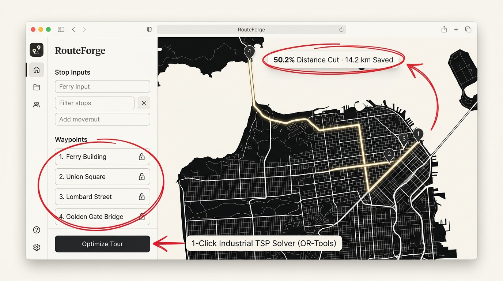
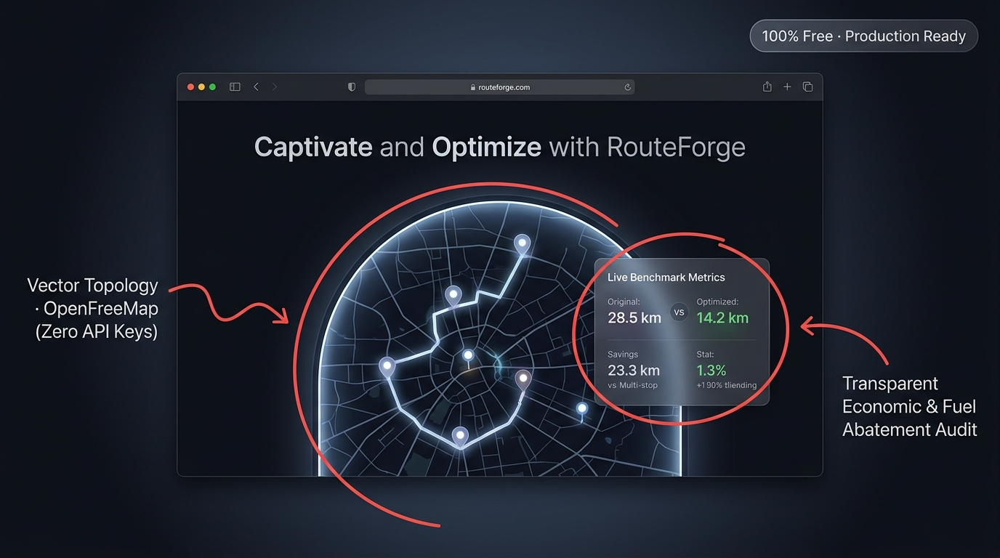

# RouteForge — Free-First Geospatial Multi-Stop Route Optimizer

[](https://www.python.org/)
[](https://fastapi.tiangolo.com/)
[](https://react.dev/)
[](https://www.typescriptlang.org/)
[](https://tailwindcss.com/)
[](https://vitejs.dev/)
[](https://maplibre.org/)
[](https://openfreemap.org/)
[](https://developers.google.com/optimization)
[](https://vercel.com/)

**RouteForge** is an industrial-grade, multi-stop route planner and Traveling Salesperson Problem (TSP) tour optimization engine built exclusively on **100% free-tier, open-source geospatial standards**. It operates locally on Windows via Python FastAPI + SQLite, and deploys to **Vercel** with zero server costs, zero credit card mandates, and zero proprietary API lockouts.

---

## Visual Showcase

### 1. Route Planning & Tour Optimization Engine


### 2. Editorial Landing Page & Live Benchmarks


---

## Core Capabilities

- **1-Click TSP Tour Solver**: Powered by Google OR-Tools Guided Local Search (GLS) and 2-opt spatial heuristics. Solves open-ended tours (dummy sink formulation), fixed origin/destinations, and locked waypoint invariants (🔒).
- **Sub-Meter Universal Geocoding**: Real-time Komoot Photon search, direct decimal coordinate parsing, Google Maps URL decoder, and zero-lag map pinpointing.
- **OpenFreeMap Vector Cartography**: MapLibre GL JS rendering Positron, Liberty, and Bright vector styles. Zero API keys, zero watermarks, 100% free forever.
- **Google Maps Style Transport Modes**: Authentic SVG icons with live travel duration estimates for **Driving** (Car), **Cycling** (Bicycle), and **Walking** (Pedestrian).
- **Economic & Environmental Audit**: Real-time telemetry calculating road kilometers abated, driver hours saved, fuel saved ($L$ and $\$$), and carbon reduction ($\text{kg CO}_2$).
- **Dual Deployment Architecture**:
  - **Local Desktop**: Fast Python FastAPI backend + SQLite database on `http://127.0.0.1:8000`.
  - **Vercel Cloud**: 100% autonomous client-side engine with OSRM and in-browser TSP solver.

---

## Quick Start (Local Windows)

### 1-Click Launch (Recommended)
Double-click `start_routeforge.bat` or run in Command Prompt:

```cmd
cd /d C:\Users\Priyansh\Desktop\ROUTE-FORGE0
start_routeforge.bat
```
*Automatically validates Python dependencies, compiles Vite assets, verifies SQLite database, and opens **`http://127.0.0.1:8000`**.*

### Frontend Development Mode
```cmd
cd local\client
npm run dev
```
*Accessible at `http://localhost:5173` with instant hot-reload.*

---

## Deploying to Vercel (Free Hobby Tier)

Deploy straight from Command Prompt using the Vercel CLI:

```cmd
cd /d C:\Users\Priyansh\Desktop\ROUTE-FORGE0
npx vercel --prod
```

Or push to GitHub and import via the Vercel Dashboard:
```cmd
git init
git add .
git commit -m "feat: RouteForge publication release"
git branch -M main
git remote add origin https://github.com/<your-username>/routeforge.git
git push -u origin main
```
*The included [`vercel.json`](vercel.json) configures Vite building and SPA rewrites automatically.*

---

## Repository Structure

```
ROUTE-FORGE0/
├── backend/                  # Python FastAPI Backend & OR-Tools Solver
│   ├── main.py               # REST API endpoints & static serving
│   ├── optimizer.py          # Google OR-Tools Guided Local Search TSP
│   ├── router.py             # OSRM road graph client & turn maneuvers
│   ├── geocoder.py           # Photon & Nominatim geocoding engine
│   ├── database.py           # SQLite persistence layer with revision guards
│   ├── run_server.py         # Direct Python entry point
│   └── stop_server.py        # Process shutdown utility
├── local/client/             # React 18 + Vite Frontend
│   ├── src/
│   │   ├── components/       # LandingPage, Map, StopList, MetricsBar, Modals
│   │   ├── services/         # api.ts, clientRouting.ts, geocodingService.ts
│   │   └── types.ts          # Core TypeScript contracts
│   └── dist/                 # Production compiled Vite assets
├── docs/                     # Technical Architecture & Deployment Guides
│   ├── assets/               # High-res annotated screenshots for GitHub/LinkedIn
│   ├── DEPLOYMENT.md         # Vercel & Render cloud setup
│   ├── API_CONFIGURATION.md  # Endpoint definitions
│   └── TESTING.md            # Automated testing guide
├── start_routeforge.bat      # 1-Click Windows execution script
├── stop.bat                  # Safe server stop script
├── vercel.json               # Vercel Hobby deployment manifest
└── requirements.txt          # Python dependencies (fastapi, ortools, etc.)
```

---

## License
MIT License. Open-source geospatial architecture.
