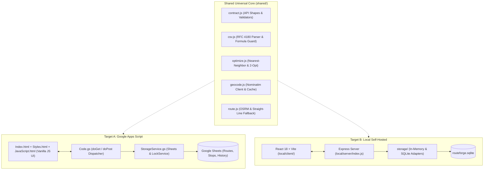

# RouteForge: Dual-Target Collaborative Route Planner

[](https://nodejs.org/)
[](https://react.dev/)
[](https://leafletjs.com/)
[](https://developers.google.com/apps-script)
[](https://opensource.org/licenses/MIT)

**RouteForge** is a production-ready, collaborative multi-stop route planning system built from a single unified codebase to deploy across two targets:

1. **Target A: Google Apps Script Web App** — Hosted directly on Google infrastructure with Google Sheets as the relational database and zero server maintenance.
2. **Target B: Local / Self-Hosted Node.js + React Stack** — Powered by Node.js 20+, Express 4, pluggable In-Memory or SQLite persistence, React 18, Vite, and Leaflet.

Both targets implement the **exact same JSON API contract, data model, validation rules, optimization algorithms, and responsive user experience**.

---

## Architecture Overview



---

## Key Features

- **Multi-Address CSV & Text Import**: Parses RFC 4180 CSVs, quoted fields, embedded commas, newlines, Unicode, and UTF-8 BOM (`\uFEFF`) with line-numbered error diagnostics.
- **Geocoding with Throttling & Caching**: OpenStreetMap Nominatim integration with a strict 1 req/sec throttler, normalized in-memory LRU cache, and manual coordinate correction.
- **Interactive Leaflet Map**: Numbered marker pins bidirectionally synchronized with the stop list and real-time road geometry polyline rendering.
- **Road Routing via OSRM**: Computes road geometry using Project OSRM with an explicitly labeled straight-line fallback engine (Haversine formula).
- **Route Optimization (Nearest-Neighbor + 2-Opt)**: Calculates distance savings percentages, preserves fixed start/end points, and strictly respects locked stops (🔒).
- **Collaborative Sync & Conflict Detection**: 3.5s revision polling with `expectedRevision` validation. Target A uses `LockService.getScriptLock()`; Target B uses a per-route async mutex. Concurrent writes return `REVISION_CONFLICT` (HTTP 409).
- **Formula-Injection Safe CSV Export**: Escapes leading dangerous triggers (`=`, `+`, `-`, `@`, `\t`, `\r`) with single quotes (`'`) to protect spreadsheet users.

---

## How to Run Target B (Local Node.js + React)

Target B provides a local development and self-hosted environment using Express and React 18.

### 1. Prerequisites
- **Node.js**: v20.0.0 or later (v24.20.0 supported)
- **npm**: v10.0.0 or later

### 2. Install Dependencies
Run the following commands from the repository root:

```bash
# Install backend and workspace dependencies
cd local
npm install

# Install client dependencies
cd client
npm install
cd ../..
```

### 3. Run the Development Server
From the repository root, run:

```bash
npm run dev
```

This concurrently launches:
- **Backend API**: `http://localhost:3001`
- **React Client**: `http://localhost:5173` (with automatic `/api` proxying)

Open **`http://localhost:5173`** in your browser.

### 4. Running with SQLite Disk Persistence
By default, Target B runs with `STORAGE=memory` for zero-setup ephemeral testing. To persist routes and stops to a SQLite database file across server restarts:

```bash
# Windows (PowerShell)
$env:STORAGE="sqlite"; npm --prefix local run server

# Windows (CMD)
set STORAGE=sqlite && npm --prefix local run server

# Linux / macOS
STORAGE=sqlite npm --prefix local run server
```

The server automatically initializes `./local/server/routeforge.sqlite` with `Routes`, `Stops`, and `RouteHistory` tables mirroring the Google Sheets schema field-for-field.

### 5. Cross-Device LAN Testing (Phone + Laptop)
To test collaborative synchronization between your computer and a smartphone on the same Wi-Fi network:

1. Determine your computer's local network IP address:
   - Windows: Run `ipconfig` (look for your Wi-Fi IPv4 address, e.g. `192.168.1.50`).
   - macOS / Linux: Run `ifconfig` or `ip addr`.
2. Start the dev server (it already binds to `0.0.0.0` by default):
   ```bash
   npm run dev
   ```
3. Open `http://<your-lan-ip>:5173` on your smartphone browser.
4. Open `http://localhost:5173` on your computer.
5. Create a route on your computer, copy the share link (`?routeId=...`), and open it on your phone.
6. Make edits on either device; changes sync within 3.5 seconds!

> [!NOTE]
> Ensure your local firewall allows inbound traffic on ports 5173 and 3001.

### 6. Production Build & Run
To compile the client into optimized production static assets and run a unified standalone server:

```bash
# Build the React production bundle into local/client/dist
npm run build

# Start the unified production server
npm run start
```
Open **`http://localhost:3001`**. The Express server directly serves both the API and the production client bundle.

---

## How to Run Target A (Google Apps Script Web App)

Target A runs serverless on Google Apps Script and uses Google Sheets as its persistence store.

### 1. Prerequisites
- A **Google Account** (personal or Google Workspace).
- Google Clasp CLI installed globally:
  ```bash
  npm install -g @google/clasp
  ```
- Log in to your Google account with clasp:
  ```bash
  clasp login
  ```
  *(Verify that the Google Apps Script API is enabled under [script.google.com/home/usersettings](https://script.google.com/home/usersettings)).*

### 2. Create the Google Sheet Database
1. Go to [Google Sheets](https://sheets.new) and create a new blank spreadsheet.
2. Name it `RouteForge-Database`.
3. Copy the **Spreadsheet ID** from the URL:
   ```
   https://docs.google.com/spreadsheets/d/<SPREADSHEET_ID>/edit
   ```

### 3. Deploy Code via Clasp
From the repository root:

```bash
cd apps-script

# Option A: Create a new Apps Script Web App project
clasp create --type webapp --title "RouteForge"

# Option B: Or clone an existing Apps Script project ID
# clasp clone <YOUR_SCRIPT_ID>

# Push all .gs and .html files to Apps Script
clasp push
```

### 4. Initialize Database Schema
1. Open the Apps Script online editor:
   ```bash
   clasp open
   ```
2. In the Apps Script editor:
   - Click **Project Settings** (gear icon on left).
   - Under **Script Properties**, click **Add script property**:
     - **Property**: `SHEET_ID`
     - **Value**: `<YOUR_SPREADSHEET_ID>` (from Step 2).
   - Click **Save script properties**.
3. In the code editor, select `Configuration.gs`.
4. In the function dropdown at the top, select `initializeApp` and click **Run**.
5. When prompted, click **Review permissions** and authorize the requested scopes (Google Sheets and external requests).
6. Switch to your Google Sheet: confirm that `Routes`, `Stops`, and `RouteHistory` tabs have been generated with frozen headers.

### 5. Deploy as a Web App
1. In the top-right corner of the Apps Script Editor, click **Deploy** > **New deployment**.
2. Click the gear icon next to "Select type" and choose **Web app**.
3. Configure the deployment settings:
   - **Description**: `RouteForge v1.0`
   - **Execute as**: `Me (<your-email@gmail.com>)`
   - **Who has access**: `Anyone with the link` (or `Anyone` for public collaboration)
4. Click **Deploy**.
5. Copy the generated **Web app URL**:
   ```
   https://script.google.com/macros/s/<DEPLOYMENT_ID>/exec
   ```

### 6. Using Target A
Open the web app URL in any desktop or mobile browser. RouteForge will generate a route identifier (e.g. `?routeId=rf_...`) and persist all stops and revisions directly to your Google Sheet!

---

## Running Automated Tests

RouteForge includes a test suite covering shared logic, both storage adapters, and a complete 12-step end-to-end acceptance simulation.

From the repository root:

```bash
# Run all test suites
npm test

# Run individual suites
npm run test:shared   # Contract, CSV, optimizer, route unit tests
npm run test:server   # Memory & SQLite storage adapter integration tests
npm run test:e2e      # Full 12-step end-to-end HTTP API workflow test
```

### Test Suite Summary

```
Testing Shared Modules...
✓ Contract & validation tests passed
✓ CSV parser and export formula injection tests passed
✓ Optimizer nearest-neighbor & 2-opt tests passed
✓ Straight-line route fallback test passed

Starting RouteForge Storage Integration Tests...
--- Testing Storage Adapter: In-Memory ---
✓ In-Memory adapter passed all CRUD, transaction, and revision conflict tests!
--- Testing Storage Adapter: SQLite (Disk) ---
✓ SQLite (Disk) adapter passed all CRUD, transaction, and revision conflict tests!

--- Starting RouteForge End-to-End Acceptance Test ---
✓ Test Express server running on http://127.0.0.1:3999/api
✓ Route created: ID = rf_..., revision = 1
✓ 4 stops added and numbered; revision is now 5
✓ Route calculated: Distance = 15216m (straightLine)
✓ Optimization complete: Original = 15216m, Optimized = 9973m, Savings = 5243m (34.46%)
✓ Second device received identical route state and revision
✓ Device 2 polling detected updated revision 7
✓ Revision conflict correctly detected and rejected with HTTP 409 REVISION_CONFLICT
✓ Route data persists accurately
✓ Exported CSV successfully sanitized against spreadsheet formula injection

======================================================
✓ ALL 12 ACCEPTANCE CRITERIA WORKFLOWS VERIFIED 100%
======================================================
```

---

## Repository Structure

```
RouteForge/
├── shared/
│   ├── contract.js             # API request/response shapes & validators
│   ├── csv.js                  # RFC 4180 parser & formula injection guard
│   ├── optimize.js             # Nearest-neighbor + 2-opt optimization core
│   ├── geocode.js              # Nominatim client, 1 req/sec throttler, LRU cache
│   ├── route.js                # OSRM router + labeled straight-line fallback
│   └── types.js                # JSDoc type definitions
│
├── apps-script/
│   ├── appsscript.json         # Manifest, scopes, and web app settings
│   ├── Code.gs                 # Web app entry point (doGet, doPost, API router)
│   ├── Configuration.gs        # Sheet bindings and schema initialization (initializeApp)
│   ├── StorageService.gs       # Sheets CRUD adapter with LockService transactions
│   ├── RouteService.gs         # Route calculation & coordination
│   ├── SyncService.gs          # Revision verification
│   ├── OptimizationService.gs  # Apps Script wrapper for optimizer
│   ├── GeocodingService.gs     # Apps Script Nominatim client with CacheService
│   ├── Index.html              # Web app HTML shell
│   ├── Styles.html             # SaaS dashboard stylesheet
│   └── JavaScript.html         # Client controller & polling engine
│
├── local/
│   ├── server/
│   │   ├── index.js            # Express server entry point
│   │   ├── config.js           # Server configuration & environment variables
│   │   ├── routes.js           # API route handlers with async mutex
│   │   └── storage/
│   │       ├── memory.js       # In-memory storage adapter
│   │       └── sqlite.js       # SQLite adapter (better-sqlite3 + sql.js)
│   ├── client/
│   │   ├── vite.config.js      # Vite dev server configuration
│   │   ├── package.json        # Client dependencies
│   │   └── src/
│   │       ├── main.jsx        # React application bootstrap
│   │       ├── App.jsx         # State coordinator & revision polling
│   │       ├── Map.jsx         # Interactive Leaflet map with custom pins
│   │       ├── StopList.jsx    # Stop list, lock toggles, reordering, editing
│   │       ├── Import.jsx      # CSV / paste addresses import modal
│   │       ├── Sync.jsx        # Connection status pill
│   │       └── styles.css      # SaaS styling
│   └── package.json            # Local workspace scripts
│
├── docs/
│   ├── DEPLOY_APPS_SCRIPT.md   # Step-by-step clasp deployment guide
│   ├── DEPLOY_LOCAL.md         # Local setup, LAN exposure, and persistence
│   ├── PROVIDERS.md            # Nominatim and OSRM policies and compliance
│   └── KNOWN_LIMITATIONS.md    # Honest gap analysis and quota limitations
│
├── tests/
│   ├── shared.test.js          # Shared module unit tests
│   ├── server.test.js          # Storage adapter integration tests
│   └── e2e.test.js             # End-to-end acceptance workflow test
│
├── TESTING.md                  # Test report & manual verification steps
└── README.md                   # This document
```

---

## API Contract (Byte-Identical Across Both Targets)

All endpoints accept and return standard JSON.
- **Target A**: Handled by `doGet(e)` / `doPost(e)` on the web app URL via `?action=<name>`.
- **Target B**: Handled by Express on `POST /api/<name>`.

### Response Envelopes

**Success Envelope:**
```json
{
  "ok": true,
  "data": { ... },
  "revision": 12
}
```

**Error Envelope:**
```json
{
  "ok": false,
  "error": {
    "code": "REVISION_CONFLICT",
    "message": "Route was modified by another user."
  }
}
```

### Endpoints

| Action | Input Payload | Description |
|---|---|---|
| `initializeApp` | None | Initializes database sheets or SQLite tables |
| `createRoute` | `{ title }` | Creates route; returns `{ routeId, revision, url }` |
| `getRoute` | `{ routeId }` | Fetches route metadata, ordered stops, and history |
| `getRouteRevision` | `{ routeId }` | Lightweight endpoint for 3.5s sync polling |
| `updateRoute` | `{ routeId, expectedRevision, changes }` | Updates title or settings; checks revision |
| `addStop` | `{ routeId, expectedRevision, stop }` | Adds stop (with automatic Nominatim geocoding) |
| `removeStop` | `{ routeId, expectedRevision, stopId }` | Removes stop and re-indexes sequence |
| `reorderStops` | `{ routeId, expectedRevision, sequence }` | Updates sequence order of stops |
| `updateStop` | `{ routeId, expectedRevision, stopId, changes }` | Updates stop name, address, or lock state |
| `calculateRoute` | `{ routeId, provider }` | Computes road geometry via OSRM or straight-line |
| `optimizeRoute` | `{ routeId, options }` | Runs Nearest Neighbor + 2-Opt with locked stops |
| `exportRoute` | `{ routeId, format: 'csv' }` | Generates formula-injection-safe CSV file |

---

## Security Model

1. **Shared-Link Collaboration**:
   - Anyone possessing the share URL can view and edit the route.
   - For Target B, an optional `AUTH_MODE=shared-secret` environment flag is supported.
2. **Formula Injection Guard**:
   - All CSV exports sanitize leading dangerous formula triggers (`=`, `+`, `-`, `@`, `\t`, `\r`) by prepending a single quote (`'`), preventing malicious code execution when opened in Microsoft Excel or Google Sheets.
3. **Transaction Safety & Revision Checking**:
   - Both targets require `expectedRevision` on every state modification.
   - Target A uses `LockService.getScriptLock()` around the read-increment-write sequence.
   - Target B uses a per-route asynchronous mutex. Mismatches return `REVISION_CONFLICT` to protect against lost updates.

---

## Further Documentation

- [Google Apps Script Deployment Guide](file:///c:/Users/Priyansh/Desktop/ROUTE-FORGE0/docs/DEPLOY_APPS_SCRIPT.md)
- [Local Deployment & LAN Testing Guide](file:///c:/Users/Priyansh/Desktop/ROUTE-FORGE0/docs/DEPLOY_LOCAL.md)
- [External Providers & Policies Guide](file:///c:/Users/Priyansh/Desktop/ROUTE-FORGE0/docs/PROVIDERS.md)
- [Known Limitations & Architecture Decisions](file:///c:/Users/Priyansh/Desktop/ROUTE-FORGE0/docs/KNOWN_LIMITATIONS.md)
- [Test Report & Manual Verification Procedure](file:///c:/Users/Priyansh/Desktop/ROUTE-FORGE0/TESTING.md)

---

## License

MIT License. Designed and built for collaborative logistics, route optimization, and multi-target deployment.
